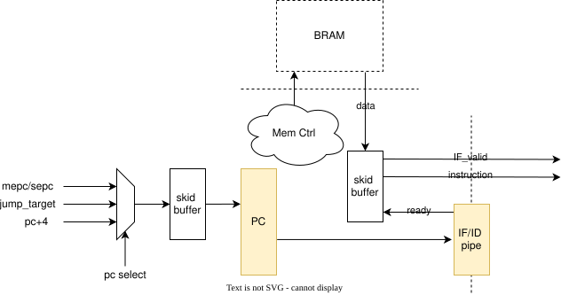
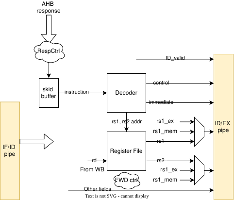
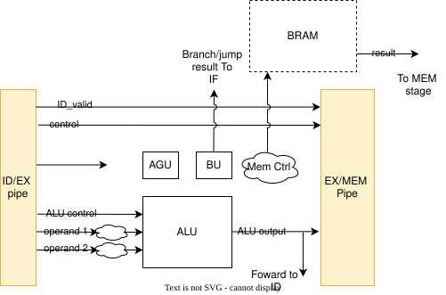
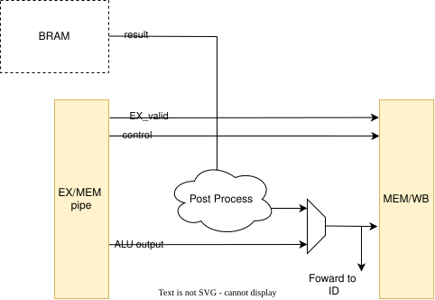
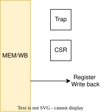
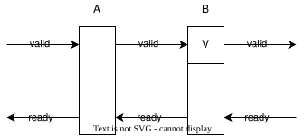

# CPU Microarchitecture

## 5 Stage Pipeline

The TinyLinuxRV CPU implements the classic 5 stage pipeline with IF, ID, EX, MEM, and WB stage.

----------------------------------------

### IF stage



IF stage is responsible for fetching the instruction. It contains the following components:
- PC
- Instruction Memory Control logic

#### PC

- PC stands for program counter, it's the address for the next instruction to be executed.
- In usual case, PC advance to next instruction which is `PC + 4`. However, a jump, taken branch, or exception/interrupt might alter PC to another target address.
- The PC register will only be updated when IF stage is NOT stalled.
- A PC skid buffer is added to handled the case when jump/taken branch/exception/interrupt is updating PC while stall is requested by IF stage itself.

#### Instruction Memory Control Logic

In our design, we use AHB-lite bus protocol as the bus to communicate with memory subsystem.

Each AHB-lite transaction has two phases, ADDR and DATA phases. The AHB-lite transaction is also a pipelined so in ideal
case, we can send new transaction in every cycle (if not WAIT state request by device). However, considering the memory
controller latency we may not be able to do so in reality.

The IF stage only handles the ADDR phase. There are 2 states: `IDLE` and `RUN`

- During reset, IF stays at `IDLE` state.
- After getting out of reset, we enter at `RUN` state and start to send read request to memory.

To simplify the logic, **we only send read request to the memory if the IF stage is not stalled and the AHB bus is ready to accept next request `(HREADY=1)`**

However, this might introduce another control hazard. We use a similar method for load/store instruction. EX stage handles the addr phase and
mem stage handles the data phase. EX stage only send request when `HREADY=1`.

This creates a **deadlock** situation: Host need to wait to for `HREADY` before sending request. Arbiter need request to determine who should get the grant.
In order to solve the deadlock, in our design, when there is a load/store instruction, it will block the IF stage from fetching instruction

#### Pipeline Stall

There are 2 possible cases:

- Case 1: Stall requested from IF stage
  - IF will wait till the AHB bus is ready to take new request.  If the bus is not ready, IF will insert bubble to ID stage.
- Case 2: Stall requested from downstream stage.

#### Pipeline Flush

When IF flush is requested, just simply flush the IF stage and pipeline register.

If ID stage is still waiting for the previous instruction and stalling IF, IF should cancel stall request and flush. This is good because ID stage should also be flushed as well. (Put an assertion). When the next instruction is ready, it will be invalidated as the ID stage should already be flushed at this time (IF/ID_valid = 0)

Meanwhile, since the AHB bus is busy, IF will not send a new request.

----------------------------------------

### ID stage



ID stage is contains the following components:
- AHB Bus Ctrl
- Instruction Skid buffer
- Instruction Decoder
- Register file
- Data forwarding Mux

#### AHB Bus Ctrl

- The ID stage is responsible for the Data phase of the AHB transaction.
- When the instruction is not available, it will insert bubble into ID stage as there is no valid instruction.
- When the instruction is ready, it will send the instruction into the skid buffer.

#### Skid buffer

The skid buffer is used to temporarily hold the previous instruction when the pipeline is stalled.

#### Instruction Decoder

- The instruction decoder is responsible for decoding the instruction into different field and control signals to control the subsequence pipeline

#### Register File

- The register file hold 32 XLEN-bit registers.
- The decoder provides the the rs1/rs2 ID and rs1/rs2 data are read from register file in SAME cycle in ID stage
- The write data coming from WB stage is written into register file.
- The write data coming from WB stage is also forwarded into rs1/rs2 data if they match with rd id to resolve data dependence issue
- x0 is always read 0 and write will be ignored.

#### Data forwarding Mux

With 5 stage pipeline there are data hazard where junior instruction could depends on senior instruction.

An instruction in ID stage could depends on the instruction in EX stage:

```asm
addi s0, t0, 1
add  s1, s0, s0
```

Or in MEM stage:

```asm
addi s0, t0, 1
ori  s2, t0, 1
add  s1, s0, s0
```

Or even both:

```asm
addi s0, t0, 1
ori  s1, t0, 1
add  s2, s0, s1
```

In order to resolve this issue, we can forward the result from EX and MEM stage into ID stage.

Once the instruction is decoded, the rs1 and rs2 id will be compared with the rd id in EX and MEM stage, if they matched and
the instruction is a valid instruction that will update rd, then the future rd data will be forwarded to ID stage.
If both EX amd MEM stage match, the data should be forwarded from EX stage

#### Pipeline Stall

In ID stage, there is another data dependent issue that will cause ID pipeline stall.

Basically when the instruction in ID stage depends on a load instruction in EX stage. For example:

```asm
lw a0, 0(t0)
addi a1, a0, 1
```

In this case, the data will not be available in EX stage so we have to wait till the data is available in MEM stage before we can proceed.
So we will need to stall the pipeline till the data is available in MEM stage.

If ID is requesting to stall the pipeline, it will de-assert `ID_ready` and set `EX_valid` to 0.

#### Pipeline Flush

- If ID is to be flushed, it will set `EX_valid` to 0.
- If ID is stalled due to load dependence, flush request will invalidate the current instruction so the stall will no longer be requested
- Register write back still happens as that is associated with the instruction in WB stage.

----------------------------------------

### EX stage



EX stage is contains the following components:
- ALU (Arithmetic and Logic Unit)
- Multiplier/Divider
- AGU (Address generation Unit)
- BU (Branch Unit)
- Memory Control

#### ALU

ALU is the responsible for performing arithmetic and logic operation. It takes 2 operands and control signal indicating which operation to be performed.

Operand 1 can be one of the following: `PC`, `RS1`, `0`
Operand 2 can be one of the following: `RS2`, `immediate value`

#### Multiplier/Divider

Responsible for RV64M extension.

#### AGU

AGU is responsible for generating the address for memory access as well as jump and branch instruction.
The load/store and JALR share almost the same logic for generate target address (with slight different)
The JAL use a slightly different logic. But essentially they are both a XLEN-bit adder.

We could use ALU to calculate the address but to achieve better timing, we choose to introduce a dedicated AGU to generate the address.

#### BU

Branch Unit is responsible for checking the condition for branch instruction.

#### Memory Control

The memory control is responsible for generating control signal for access data memory.

TODO: The AMO instruction need to read and write memory in one instruction. Will probably need a small state machine to achieve this.

#### Pipeline Stall

- For divide instruction, it can't be finished within one cycle so EX will need to be stalled.
- For a load/store instruction, if the memory does not accept the request in this cycle, EX stage will stall the pipeline till the memory is ready to accept the request.
- Similar to IF stage, a stall requested flag will be implemented to help flush logic.
- If this is requested, it will assert `EX_ready` to be 0 and set `MEM_valid` to 0

TODO: Confirm ABH wait state

#### Pipeline Flush

Flushing EX stage should in general invalidate the instruction in this stage.

Unlike IF stage, flushing EX stage must be requested before the memory request becomes irrevocable. This is usually the very first cycle of the EX stage.
This is because once we send the request to memory, we can NOT revoke this request. This requirement is in general met. This will be covered by
exception/interrupt session. (To make sure this work, the pending exception should flush all the younger pipeline stage. Interrupt is a bit tricky because  it need to know the next PC)

----------------------------------------

### MEM stage



Memory stage is in general vary simple, it takes the read data coming back from the memory and post process it based on the read instruction type.

There is also a mux to select the data from ALU (pipeline stage) and the memory read data. If the instruction is a memory read, then use the read data. Otherwise use the ALU output.

#### Pipeline Stall

MEM stage will not be stalled.

#### Pipeline Flush

If MEM stage is flushed, the instruction will be invalidated.

----------------------------------------

### WB stage



WB stages contains the following components:
- Register file write back
- CSR
- Exception/Interrupt (Trap) handling logic

#### Register file write back

WB stage will write the data back to register file is applicable.


#### CSR

TODO

#### Trap

TODO

----------------------------------------

### Pipeline Control

To simplify the design, instead of using a centralized pipeline control, we use valid/ready control for pipeline




The next pipeline stage only accept data from previous stage when both valid and ready are asserted.
```c
valid_B = valid_A & ready_B
```

The pipeline is ready to accept data from previous stage if current stage is empty or next stage is also ready to accept data
```
ready_A = !valid_A | ready_B
```
