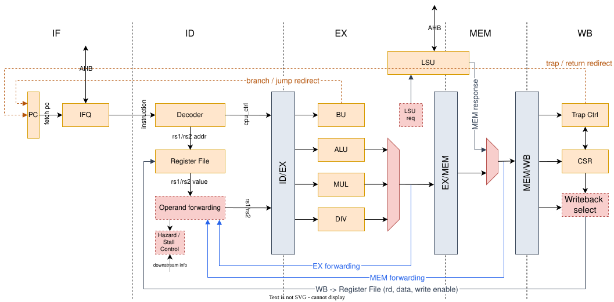
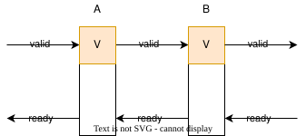
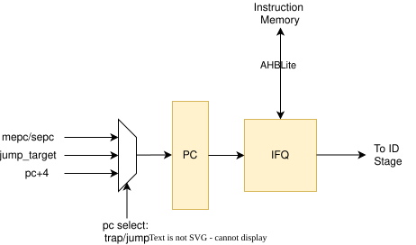
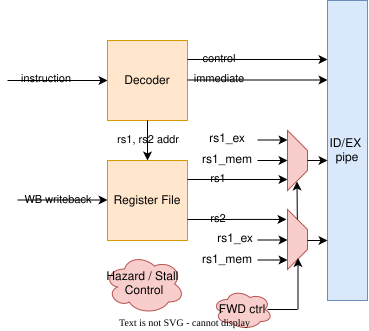

# CPU Microarchitecture

- [CPU Microarchitecture](#cpu-microarchitecture)
  - [1. Overview](#1-overview)
    - [Supported Features](#supported-features)
    - [Block Diagram](#block-diagram)
  - [2. Pipeline Control](#2-pipeline-control)
    - [Basic pipeline control](#basic-pipeline-control)
    - [Stall and Back-pressure](#stall-and-back-pressure)
    - [Flush and PC redirect](#flush-and-pc-redirect)
    - [Data forwarding](#data-forwarding)
    - [Stall Hazard](#stall-hazard)
  - [3. Pipeline stages](#3-pipeline-stages)
    - [IF stage](#if-stage)
    - [ID stage](#id-stage)
  - [4. Memory access](#4-memory-access)
    - [IFQ](#ifq)


## 1. Overview

The TinyLinuxRV CPU implements a 64 bit RISC-V CPU core.

### Supported Features
- 64 bit only
- RV64IMA ISA.
- All 3 privilege modes (U/S/M).
- Precise exception and interrupt.
- AHB-Lite bus protocol for instruction and data access
- TBD: MMU will be supported later

### Block Diagram

The CPU is implemented as class five-stage pipeline microarchitecture with IF, ID, EX, MEM, and WB stage.

It is a single issue and in-order execution CPU.



## 2. Pipeline Control

### Basic pipeline control

To simplify the design, instead of using a centralized pipeline control, we use valid/ready handshake for pipeline advancing



When both of the valid and ready are asserted. The data is moving to the next pipeline stage:

```c
advance = valid_A & ready_B
```

The `valid` here indicate that the pipeline stage carries **VALID** instructions. While this instruction could have triggered some exceptions or logged with an interrupt. In this case, the corresponding control signal would be invalidated so that the instruction will NOT be executed. But the pipeline stage still carries a **VALID** instruction.

### Stall and Back-pressure

#### Stall

When a pipeline stage can't complete at 1 cycle, it will stall the previous stage by de-asserting the `ready` signal. The `ready` signal shall be propagated all the way to IFQ. Meanwhile, it will clear the `valid` signal going to next stage.

When the instruction completes and stall is no longer required, it shall assert `ready` again and move forward.

#### Back-pressure

If the next stage is not ready to take the data, it will de-assert `ready`. In this case, the pipeline should hold its contents by NOT accepting data from previous stage even when the current stage does NOT carry a valid instruction. As this could break the dependency and forwarding logic.

It will also de-assert its `ready` signal to previous stage to indicate that it can NOT take any new data.

When downstream can move forward, it will assert its `ready` signal indicating it can receive data.

### Flush and PC redirect

A jump instruction, taken branch instruction or trap will redirect the next instruction to the calculated target PC. In this case, all the pipeline stages prior to the stage where the instruction requiring redirect is located will be invalidated (flushed).

Another source of flush request comes from exception and interrupt. If there are exception/interrupt logged in the pipeline stage, when it reaches EX and later stage, it will flush the pipeline before it. This because the exception/interrupt are handled at WB stage and it will redirect PC to a different address, and we need to stop execute any instruction after that.

For more information about exception and interrupt, check the CSR and Trap section.

When flush is requested, the pipeline stage will clear `valid` signal going to next stage indicating there is no valid instruction.

If the pipeline stage is stalled when flush is requested, the stall shall be cancelled as the instruction is no longer valid. However, back-pressure (`ready=0`) might still exists. Flush will not cancel any back-pressure from later stage.

### Data forwarding

The classic five-stage pipeline structure has data hazard when younger instruction depends on older instruction. For example:

```assembly
# ID depends on EX
addi s0, t0, 1      # EX (rd = s0)
add  s1, s0, s0     # ID (rs1, rs2 = s0)

# ID depends on MEM
addi s0, t0, 1      # MEM (rd = s0)
ori  s2, t0, 1      # EX
add  s1, s0, s0     # ID  (rs1, rs2 = s0)

# ID depends on both EX and MEM
addi s0, t0, 1      # MEM (rd = s0)
ori  s1, t0, 1      # EX  (rd = s1)
add  s2, s0, s1     # ID  (rs1 = s0, rs2 = s1)
```

In order to resolve the dependence issue, register result can be forwarded from later stage (EX or MEM) into ID stage. (As shown in the block diagram: EX forwarding and MEM forwarding)

When the instruction is decoded in ID stage, the rs1 and rs2 address will be compared with the rd address in EX and MEM stage, if

- 1) any of the source reg matches destination reg and
- 2) the instruction in EX/MEM is valid and writes rd

Then the future rd data will be forwarded to ID stage.
If both EX and MEM stage match, the data should be forwarded from EX stage

### Stall Hazard

In some cases, the pipeline need to be stalled due to other reason other then instruction taking more than ONE cycle to complete.
For such cases, they are checked and stalled at the **ID** stage.

- Case 1: When EX stage is a Load/LR instruction and ID stage instruction depends on the result of the load.
    - **Reason**: The earliest availability of the read data is in MEM stage
    - **Action:** Stall ID stage till the Load instruction reach MEM stage.

- Case 2: When LR is followed by an SC.
    - **Reason**: LR completes at MEM stage so SC need to wait till LR reach MEM stage
    - **Action:** Stall ID stage till the LR instruction reach MEM stage.

- Case 3: When EX stage is a SC instruction and ID stage instruction depends on the result of the SC
    - **Reason**: SC completes at MEM stage
    - **Action:** Stall ID stage till the SC instruction reach MEM stage.

- Case 4: CSR register access. All instructions in ID wait until the CSR instruction retires.
    - **Reason**:
      - An instruction could depend on the result of CSR and CSR read happens at WB stage.
      - Serialize CSR instruction for exception and interrupt.
    - **Action:** Stall ID stage till the CSR instruction **retires** WB stage. (meaning no CSR instruction in EX/MEM/WB stage)

- Case 5: Interrupt request pending at ID stage and CSR instruction in pipeline or just retired at WB stage
    - **Reason**: The trap control logic in WB stage register the interrupt request/eligibility adding additional latency.
                  The CSR instruction could change interrupt eligibility by writing to interrupt control related CSR.
    - **Action:** Stall ID stage till the CSR instruction **retires** WB stage plus wait one more cycle after CSR retires.

## 3. Pipeline stages

### IF stage



IF stage is responsible for fetching the instruction. It contains the following components:
- PC
- IFQ (Instruction Fetch Queue)

#### PC

- PC stands for program counter. It's the address for the next instruction to be fetched from memory.
- When IFQ accepts request, PC will advance to the address of next instruction which is `PC + 4`.
- When PC is redirected, the PC is updated to the new address. A jump, taken branch, or exception/interrupt will redirect PC.

#### IFQ (Instruction Fetch Queue)

In order to decouple the AHB addr and data phase from IF and ID stage, an IFQ is created. The IFQ takes the request from
IF stage and handles the AHB bus protocol. It will buffer the received data (instruction) in its internal first-word-fall-through
FIFO and the instruction is consumed directly by ID stage. It will also store the PC associated with each instruction.
So the IFQ is acting like the pipeline register for IF/ID stage.

### ID stage



ID stage contains the following logic:
- Instruction Decode
- Register File
- Data forwarding Logic
- Stall/Hazard Unit

#### Instruction Decode

The instruction output from IFQ is decoded by Decoder in ID stage. The instruction is decoded into different control and data signals.
These signals will be used in later stage.

When ID is free-running, it will consume the instruction from IFQ. But when ID stage is stalled, ID will back-pressure IFQ
and the instruction will be stored in IFQ itself till ID is running again.

When the instruction is not supported or not decoded to any valid RISC-V instruction, decoder will generate illegal instruction exception.

#### Register File

- The register file holds 32 XLEN-bit registers.
- The instruction decoder provides the rs1/rs2 address and rs1/rs2 value are read from register file in SAME cycle.
- The write data coming from WB stage is written into register file.
- The write data coming from WB stage is also forwarded into rs1/rs2 value directly if they match with rd address in order to resolve data dependence issue
- x0 will always be read as zero.

#### Data Forwarding Logic

Check [Data forwarding](#data-forwarding).

#### Stall/Hazard Unit

Check [Stall Hazard](#stall-hazard)

## 4. Memory access

### IFQ

The Instruction Fetch Queue (IFQ) is responsible for

- Handling AHB-Lite Bus protocol
- Buffering the received data (instruction) and send the instruction to ID stage
- Handling flush and back-pressure from ID stage

IFQ contains:

- AHB-Lite control logic.
- A First Word Fall Through (FWFT) FIFO storing the instruction and the response error status.
- Another First Word Fall Through FIFO storing the associated PC.

IFQ replaces the original IF/ID pipeline register and decouples the AHB transaction and pipeline stage.

The Depth (FIFO depth) of the IFQ is configurable through parameter. Currently it is configured to be 2.

#### AHB-Lite Control

A simple state machine is used to handle the wait state in AHB bus:

| State  | Description                                              |
| ------ | -------------------------------------------------------- |
| `INIT` | No address is currently waiting for acceptance           |
| `WAIT` | A valid AHB address phase is being held until `HREADY=1` |

State transitions:

| Current State | Next State | Condition                                |
| ------------- | ---------- | ---------------------------------------- |
| `INIT`        | `WAIT`     | `req_valid` && `req_ready` && `HREADY=0` |
| `WAIT`        | `INIT`     | `HREADY=1`                               |

When IFQ is in `WAIT` state, PC could be updated to next value since from IF point of view the request has already been accepted. IFQ will keep an internal `pending_pc` to serve as the address for `WAIT` state.

#### PC and Instruction FIFO

- The received data (instruction) and the associated PC will be stored at the FIFO. The output of the FIFO talks to ID stage directly.
- The PC is pushed into PC FIFO when the request is accepted by IFQ and the instruction is pushed into instruction FIFO when the AHB response comes back.
- Both FIFOs are poped together when ID stage consumes the instruction
- When PC FIFO is full, IFQ will stop accepting new request from IF stage and IF will be stalled.
- When flush is requested, both FIFOs will be reset to initial state

#### Flush Logic

IFQ will be flushed when IF stage is flushed. It will clear the internal FIFO and invalidate the pending AHB request that is not completed yet.

The AHB wait state could make the flushing logic complicated since the AHB-Lite protocol requires that host can NOT
cancel a pending request in wait state. IFQ needs to complete the bus transaction while remembering to discard the response.

The IFQ uses two flag registers:

A `pending_resp` register indicates that AHB address phase is completed so there is a valid response need to be received
and processed later. Only when `pending_resp=1`, the response will be pushed into the FIFO. A flush will clear `pending_resp`

A `pending_flush` register indicates that a flush is requested when the request is waiting for `hready`. In this case,
the request has not been accepted so it needs to remember not to set the `pending_resp` when the request is accepted.
