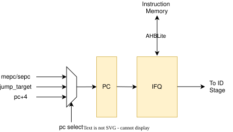
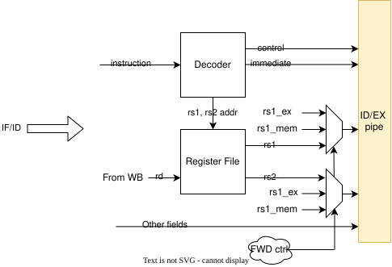
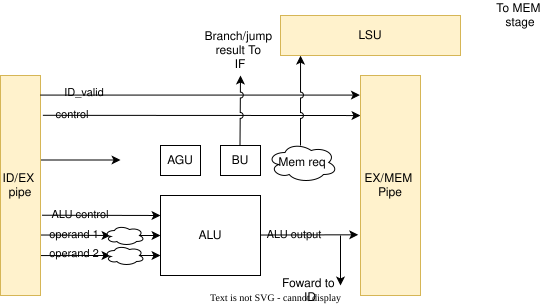
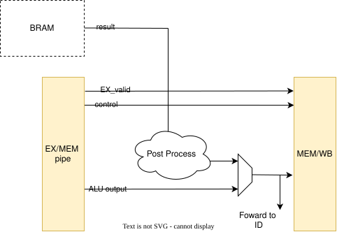
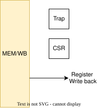
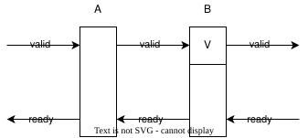

# CPU Microarchitecture

## 5 Stage Pipeline

The TinyLinuxRV CPU implements the classic 5 stage pipeline with IF, ID, EX, MEM, and WB stage.

----------------------------------------

### IF stage



IF stage is responsible for fetching the instruction. It contains the following components:
- PC
- IFQ (Instruction Fetch Queue)

#### PC

- PC stands for program counter, it's the address for the next instruction to be executed.
- In usual case, PC advance to next instruction which is `PC + 4`. However, a jump, taken branch, or exception/interrupt might alter PC to another target address.

#### IFQ (Instruction Fetch Queue)

In our design, we use AHB-lite bus protocol as the bus to communicate with memory subsystem.

Each AHB-lite transaction has two phases, ADDR and DATA phases. In order to decuple the pipeline control (stall/flush)
with AHB bus, an IFQ is designed to handle the instruction fetch from the memory.


### Submodule: IFQ

The Instruction Fetch Queue (IFQ) is responsible for fetching instructions through the AHB-Lite interface and forwarding completed instructions to the ID stage.

The IFQ replaces the original IF/ID pipeline register and decouples the AHB transaction timing from downstream pipeline stall and flush control.

The IFQ contains:

- A First Word Fall Through (FWFT) FIFO storing the AHB response `{instruction, error}`.
- A Regular FIFO storing the `PC`
- One pending address register for an AHB address phase blocked by `HREADY=0`.
- Kill information for outstanding requests invalidated by a flush.

#### AHB Control

The AHB control logic has two states:

| State  | Description                                              |
| ------ | -------------------------------------------------------- |
| `INIT` | No address is currently waiting for acceptance           |
| `WAIT` | A valid AHB address phase is being held until `HREADY=1` |

State transitions:

| Current State | Next State | Condition                               |
| ------------- | ---------- | --------------------------------------- |
| `INIT`        | `WAIT`     | New request accepted by IFQ, `HREADY=0` |
| `INIT`        | `INIT`     | Otherwise                               |
| `WAIT`        | `INIT`     | `HREADY=1`                              |
| `WAIT`        | `WAIT`     | `HREADY=0`                              |

#### Flush Logic

IFQ will be flushed when IF stage is flushed. It will clear the internal FIFO and invalidate the pending AHB request that is not completed yet.

----------------------------------------

### ID stage



ID stage is contains the following components:
- Instruction buffer
- Instruction Decoder
- Register file
- Data forwarding Mux


#### Instruction buffer

The skid buffer is used to temporarily hold the previous instruction when the pipeline is stalled.

#### Instruction Decoder

- The instruction decoder is responsible for decoding the instruction into different field and control signals to control the subsequence pipeline

#### Register File

- The register file hold 32 XLEN-bit registers.
- The decoder provides the the rs1/rs2 ID and rs1/rs2 data are read from register file in SAME cycle in ID stage
- The write data coming from WB stage is written into register file.
- The write data coming from WB stage is also forwarded into rs1/rs2 data if they match with rd id to resolve data dependence issue
- x0 is always read 0 and write will be ignored.

#### Data forwarding Mux

With 5 stage pipeline there are data hazard where junior instruction could depends on senior instruction:

```assembly

# ID depends on EX

addi s0, t0, 1      # EX (rd = s0)
add  s1, s0, s0     # ID (rs1, rs2 = s0)

# ID depends on MEM

addi s0, t0, 1      # MEM (rd = s0)
ori  s2, t0, 1      # EX
add  s1, s0, s0     # ID  (rs1, rs2 = s0)

# ID depends on both EX and MEM

addi s0, t0, 1      # MEM (rd = s0)
ori  s1, t0, 1      # EX  (rd = s1)
add  s2, s0, s1     # ID  (rs1 = s0, rs2 = s1)
```

In order to resolve this issue, we can forward the result from EX and MEM stage into ID stage.

Once the instruction is decoded, the rs1 and rs2 id will be compared with the rd id in EX and MEM stage, if they matched and
the instruction is a valid instruction that will update rd, then the future rd data will be forwarded to ID stage.
If both EX amd MEM stage match, the data should be forwarded from EX stage

#### Pipeline Stall and Flush

ID stage could be stalled due to 2 reasons

1. EX stage is stalled
2. When the instruction in ID stage depends on a load instruction in EX stage. For example:

   ```asm
   lw a0, 0(t0)
   addi a1, a0, 1
   ```
   In this case, the data will not be available in EX stage so we have to wait till the data is available in MEM stage before we can proceed.
   So we will need to stall the pipeline till the data is available in MEM stage.

A simple state machine is used to handle this. It has 2 states: `RUN` and `STALLED`.

| Current State | Next State | Condition                                     |
| ------------- | ---------- | --------------------------------------------- |
| `RUN`         | `STALLED`  | ID need to be stalled && ID stage valid       |
| `STALLED`     | `RUN`      | ID is flushed \|\| ID no longer being stalled |


----------------------------------------

### EX stage



EX stage is contains the following components:
- ALU (Arithmetic and Logic Unit)
- Multiplier/Divider
- AGU (Address generation Unit)
- BU (Branch Unit)
- Memory Control

#### ALU

ALU is the responsible for performing arithmetic and logic operation. It takes 2 operands and control signal indicating which operation to be performed.

Operand 1 can be one of the following: `PC`, `RS1`, `0`
Operand 2 can be one of the following: `RS2`, `immediate value`

#### Multiplier/Divider

Responsible for RV64M extension.

#### AGU

AGU is responsible for generating the address for memory access as well as jump and branch instruction.
The load/store and JALR share almost the same logic for generate target address (with slight different)
The JAL use a slightly different logic. But essentially they are both a XLEN-bit adder.

We could use ALU to calculate the address but to achieve better timing, we choose to introduce a dedicated AGU to generate the address.

#### BU

Branch Unit is responsible for checking the condition for branch instruction.

#### Memory Control

The memory control is responsible for generating control signal for access data memory.

TODO: The AMO instruction need to read and write memory in one instruction. Will probably need a small state machine to achieve this.

#### Pipeline Stall

- For divide instruction, it can't be finished within one cycle so EX will need to be stalled.
- For a load/store instruction, if the memory does not accept the request in this cycle, EX stage will stall the pipeline till the memory is ready to accept the request.
- Similar to IF stage, a stall requested flag will be implemented to help flush logic.
- If this is requested, it will assert `EX_ready` to be 0 and set `MEM_valid` to 0

TODO: Confirm ABH wait state

#### Pipeline Flush

Flushing EX stage should in general invalidate the instruction in this stage.

Unlike IF stage, flushing EX stage must be requested before the memory request becomes irrevocable. This is usually the very first cycle of the EX stage.
This is because once we send the request to memory, we can NOT revoke this request. This requirement is in general met. This will be covered by
exception/interrupt session. (To make sure this work, the pending exception should flush all the younger pipeline stage. Interrupt is a bit tricky because  it need to know the next PC)

----------------------------------------

### MEM stage



Memory stage is in general vary simple, it takes the read data coming back from the memory and post process it based on the read instruction type.

There is also a mux to select the data from ALU (pipeline stage) and the memory read data. If the instruction is a memory read, then use the read data. Otherwise use the ALU output.

#### Pipeline Stall

MEM stage will not be stalled.

#### Pipeline Flush

If MEM stage is flushed, the instruction will be invalidated.

----------------------------------------

### WB stage



WB stages contains the following components:
- Register file write back
- CSR
- Exception/Interrupt (Trap) handling logic

#### Register file write back

WB stage will write the data back to register file is applicable.


#### CSR

TODO

#### Trap

TODO

----------------------------------------

### Pipeline Control

To simplify the design, instead of using a centralized pipeline control, we use valid/ready control for pipeline




The next pipeline stage only accept data from previous stage when both valid and ready are asserted.
```c
valid_B = valid_A & ready_B
```

The pipeline is ready to accept data from previous stage if current stage is empty or next stage is also ready to accept data
```
ready_A = !valid_A | ready_B
```
